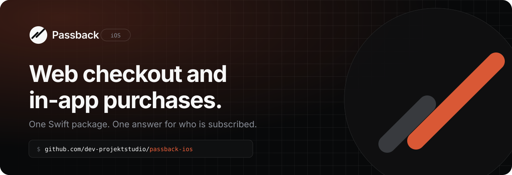

<p align="center">
  <a href="https://www.passback.app">
    <picture>
      <source media="(prefers-color-scheme: dark)" srcset=".github/assets/banner-dark.svg">
      <source media="(prefers-color-scheme: light)" srcset=".github/assets/banner-light.svg">
      
    </picture>
  </a>
</p>

<p align="center">
  <a href="https://github.com/dev-projektstudio/passback-ios/tags"></a>
  
  
  
  <a href="LICENSE"></a>
</p>

<p align="center">
  <a href="https://www.passback.app"><b>Website</b></a>
  &nbsp;·&nbsp;
  <a href="https://www.passback.app/docs"><b>Docs</b></a>
  &nbsp;·&nbsp;
  <a href="GUIDE.md"><b>Integration guide</b></a>
  &nbsp;·&nbsp;
  <a href="https://www.passback.app/register"><b>Create an account</b></a>
</p>

<br>

Passback lets an iOS app sell subscriptions on the web and in the app, and
answers one question everywhere: is this customer subscribed? Web purchases
go through your own Stripe account, with no App Store commission, and land
on the customer in the app. In-app purchases go through StoreKit 2 and are
validated on our server.

With PassbackKit you can:

- Open a web checkout funnel from your paywall, only in storefronts where Apple allows it.
- Bring a customer who paid on the web back into the app already subscribed, by link, code or email.
- Sell StoreKit 2 subscriptions and one-time purchases, with products and offerings set on the dashboard.
- Check entitlements with one `CustomerInfo`, whether the customer paid through the App Store, Google Play or the web.
- Keep using RevenueCat or Adapty: web purchases are granted on the customer's existing profile.

[Create an account](https://www.passback.app/register) to get started. In-App
is free until $2,500 in monthly tracked revenue.

## Features

| | |
|---|---|
| ✅ | Server-side validation of every StoreKit 2 transaction |
| 🌐 | Web checkout on your own Stripe account, shown only where the storefront allows it |
| 🎯 | One subscription status across iOS, Android and the web |
| 🔁 | Restore by universal link, a six-digit code, or email |
| 🤝 | Works alongside RevenueCat and Adapty, with a migration path off RevenueCat |
| ➡️ | Webhooks for purchases, renewals, cancellations and refunds |
| 🔒 | TLS 1.3, an ephemeral session, and optional public-key pinning |
| 📦 | No dependencies |

## Getting started

Follow the [integration guide](GUIDE.md) to install and configure the SDK,
or read the [docs](https://www.passback.app/docs). Your app's own snippets,
with its key and names filled in, are on the dashboard once you sign in.

## Installation

Add the package in Xcode (File → Add Package Dependencies…) with this URL:

```
https://github.com/dev-projektstudio/passback-ios
```

## Requirements

- iOS 15.0+ or macOS 12.0+
- Xcode 15.0+, Swift 5.9+

## License

PassbackKit is released under the MIT license. See [LICENSE](LICENSE).

<br>

<p align="center">
  <a href="https://www.passback.app">
    <picture>
      <source media="(prefers-color-scheme: dark)" srcset=".github/assets/mark-dark.svg">
      
    </picture>
  </a>
  <br>
  <sub>Made by Projekt Studio</sub>
</p>
